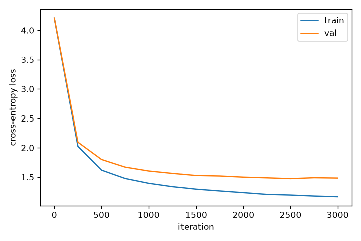

# mini-gpt

A small GPT written from scratch in PyTorch and trained on tiny Shakespeare (about 1.1M characters). I wrote the attention myself instead of using `nn.MultiheadAttention`, mostly to make sure I actually understood it.

- `model.py` has causal self-attention, the transformer block (pre-LayerNorm, GELU MLP, residuals) and the GPT with learned position embeddings and tied input/output embeddings.
- `test_model.py` checks that my attention matches `F.scaled_dot_product_attention`, that changing future tokens never changes earlier predictions, and that the untrained loss is close to ln(vocab).
- `train.py` is a plain training loop: AdamW, linear warmup then cosine decay, gradient clipping.
- `baseline.py` is a bigram model to compare against.

## Setup that I used

Character level tokenizer (65 characters), 90/10 train/val split, 4 layers, 4 heads, 256 dims, context of 128, dropout 0.1. 3.2M parameters, 3000 iterations at batch size 64, about 9 minutes on an M2 MacBook Air.

## Results

| | val loss | perplexity | bits per char |
|---|---|---|---|
| uniform guess | 4.174 | 65 | 6.02 |
| bigram counts | 2.482 | 11.96 | 3.58 |
| mini-gpt | 1.483 | 4.40 | 2.14 |



Validation loss bottomed out around iteration 2500 (1.4725) and then crept back up while train loss kept dropping, so it was starting to overfit a 1M character dataset. I kept the final checkpoint rather than the best one, which is slightly lazy. More dropout or early stopping would be the next thing to try.

## Samples

From `sample.txt`, temperature 0.8, top-k 40:

```
DUKE OF AUMERLE:
You best it please yonder too: but I know
'Go, my lord, 'tis dead of an inwray
take the husband and my father crown.

QUEEN MARGARET:
Sweet sound! The nurse is our faces to the world,
```

It picks up the play format, speaker names and rough grammar, but the sentences don't mean anything. That's about what you'd expect at this size.

## Running it

```
curl -L -o input.txt https://raw.githubusercontent.com/karpathy/char-rnn/master/data/tinyshakespeare/input.txt
uv venv --python 3.12 .venv
uv pip install --python .venv/bin/python torch numpy matplotlib
.venv/bin/python test_model.py
.venv/bin/python baseline.py
.venv/bin/python train.py
.venv/bin/python generate.py "ROMEO:"
```

The dataset is the tiny Shakespeare file from Andrej Karpathy's char-rnn repo.
